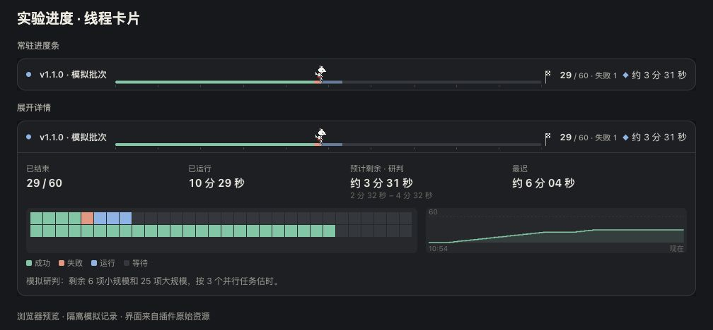
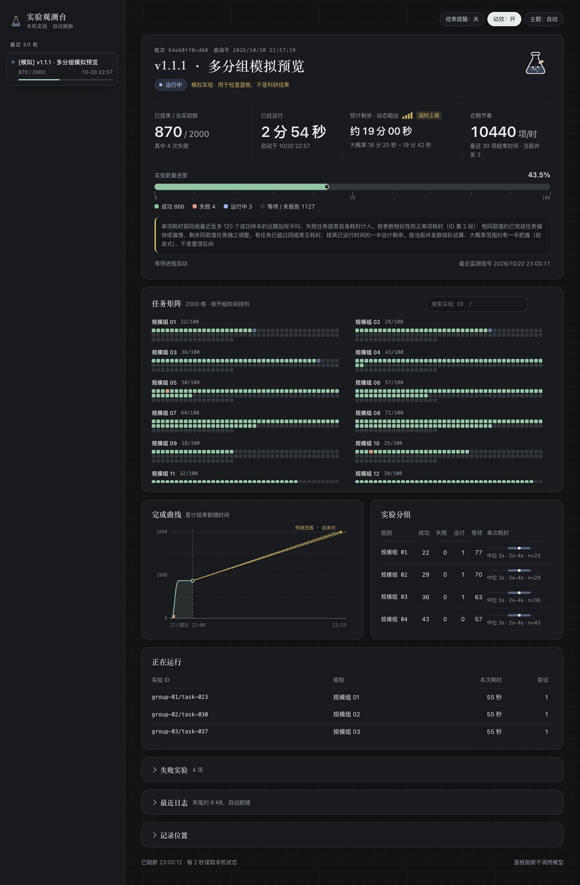

# Experiment Progress Skill

[简体中文](README.md) · [MIT license](LICENSE)

Follow local experiments inside a Codex chat, with live progress and remaining time. Expand the card for a task minimap, completion curve, and forecast basis. Open the sidebar observatory for all runs, group durations, and logs. The same local records are available through a command line and Python.



The card preview uses isolated synthetic records; Codex supplies the surrounding chat frame. A pixel wolf moves with the fraction of finished tasks. Hover, click, or use the keyboard to expand details. The card refreshes itself after being inserted once.



The sidebar observatory reuses the web dashboard's HTML and reads the same records through the plugin. The standalone web page remains available. The full view includes ID search, keyboard task inspection, group statistics, logs, themes, and a motion toggle.

## Changes in v1.1.1

The observatory arranges task groups in two columns on wide screens and scrolls within the matrix when needed. Keyboard navigation brings the selected task into view. The group table removes duplicate progress bars, keeps its header visible while scrolling, and retains all state counts on narrow screens.

## Changes in v1.1.0

- The chat card is the routine progress view, with the full observatory in the plugin sidebar. This repository now includes both the skill and an installable plugin.
- Existing silent follow-ups can write a forecast based on remaining groups, task limits, driver settings, and logs. A fresh forecast leads the display while the algorithm remains visible; an expired forecast falls back to the algorithm.
- Task limits constrain remaining-time estimates and supply a latest-finish estimate under current concurrency and limit assumptions. Replay can compare saved forecasts with the algorithm at the same moments.

## Requirements

- Python 3.9+ and its standard library; no pip packages.
- Chat cards and the sidebar require a Codex desktop host with MCP App views and this repository's plugin. The skill alone supports the command line and local web page.
- Tested on macOS. Linux has not been verified. Windows is not supported; the code uses `fcntl` and `ps`.
- A modern browser with `fetch` and `AbortSignal.timeout`. The dashboard and runtime messages are currently in Chinese; the usage instructions here cover the same features as the Chinese README.
- Experiments run on the local computer. This release does not add remote-server monitoring or web buttons to stop or retry tasks.

## Install and use in Codex

```text
$skill-installer Install https://github.com/ylimingtju/experiment-progress/tree/v1.1.1/skills/experiment-progress.
```

```text
$experiment-progress Track this background experiment and place a progress card in its chat. Inspect the existing task list and logs first. Preserve the model, algorithm, seeds, solver limits, timing definitions, and existing notification preferences.
```

Once installed, Codex may select the skill when a request matches it. It is not an operating-system-wide process detector and cannot infer trial counts for arbitrary background commands. Full counts need stable task IDs and explicit task events. Existing reliable logs may be read through an adapter. Do not rerun experiments just to add progress tracking.

See the [official OpenAI instructions](https://learn.chatgpt.com/docs/build-skills) for installation and discovery. Use a skill directory supported by your host and compare existing copies before replacing local changes.

### Install the card and sidebar plugin

Install the skill above, then add this repository as a plugin source:

```sh
codex plugin marketplace add ylimingtju/experiment-progress --ref v1.1.1
```

In the desktop host's plugin directory, select the **Experiment Progress** source, install **实验观测台**, and start a new chat. See the [official OpenAI plugin instructions](https://developers.openai.com/plugins/build/plugins) for marketplace registration and local installation. This repository distributes a GitHub plugin source.

The plugin lives in `plugins/experiment-progress/`; its own version is `0.1.3`. It provides read-only MCP tools using Python's standard library and keeps no separate experiment database. It reads `~/.codex/skills/experiment-progress/` by default; set `EXPERIMENT_PROGRESS_SKILL` in the plugin process environment for another skill location. Set `EXPERIMENT_PROGRESS_HOME` to share a custom state directory. Python 3 must be available on `PATH`.

After starting and checking an experiment, Codex calls `experiment.track(run_id=RUN_ID)` once. The card reads state every three seconds; the observatory reads it every two seconds. These refreshes do not call a model. The sidebar's observatory entry opens the full view.

## Command-line demo

```sh
git clone https://github.com/ylimingtju/experiment-progress.git
cd experiment-progress
EP="$PWD/skills/experiment-progress/scripts/experiment_progress.py"
export EXPERIMENT_PROGRESS_HOME="$(mktemp -d)"
python3 "$EP" launch --demo --name "Demo experiments" --total 15 --open -- python3 "$PWD/skills/experiment-progress/scripts/demo.py"
```

The demo takes about 25 seconds, uses a temporary state directory, and performs no research computation. Its two groups include one intentional failure and a retry with the same ID. The launcher prints `run_id`, a local `url`, and `data_dir`. `--open` opens the browser. If opening fails, use the printed address rather than launching the batch again. Keep the printed data directory if you want to revisit the demo after leaving the shell.

For real experiments, omit `--demo`, supply the actual working directory and command, and use the actual task plan. For example:

```sh
python3 "$EP" launch --name "Parameter comparison" --cwd /absolute/project --plan /absolute/project/work/plan.json -- python3 -u driver.py
```

A plan is a JSON array:

```json
[
  {"id":"bo01/30-10-2/seed0","group":"n=30","params":{"algo":"bo01","inst":"30-10-2","seed":0}},
  {"id":"bo02/60-10-2/seed0","group":"n=60","params":{"algo":"bo02","inst":"60-10-2","seed":0}}
]
```

The plan length supplies the total. Optional `params` accepts up to 20 string or numeric values and is used only for ETA. Without it, parameters come from ID segments; `/` is the recommended separator. Without a per-task plan, you can use `--total 120`; unreported tasks use the current single group or pooled samples from this run for a rough estimate. Supply the full plan when groups are known. Omit the total when it is unknown. The launched command must wait for all workers. Do not submit work and exit, add `nohup`, or append `&`.

## Report task events

Add the skill's `scripts/` directory to the experiment interpreter's module search path, for example through `PYTHONPATH` before running the launcher. Report at the original task boundaries:

```python
from experiment_progress import task, report

with task("algorithm-instance-parameter-seed", group="small"):
    run_existing_experiment()
```

`task()` records success on normal return and failure on an exception, then propagates the original exception. Monitoring errors only print a warning and do not change the experiment outcome. If the existing program encodes failure in a return value, use `report()` to follow that existing rule. A solver time limit may be a valid experimental outcome; it is not automatically an execution failure. Keep monitoring outside the original solver timing interval.

The launcher passes `EXPERIMENT_PROGRESS_RUN` and `EXPERIMENT_PROGRESS_HOME` to child processes. A retry keeps the same task ID and first reports `running`. Repeated terminal events do not double-count tasks. SQLite transactions combine writes from multiple processes.

## Common commands

```sh
python3 "$EP" dashboard --open
python3 "$EP" dashboard --restart --open
python3 "$EP" status --run RUN_ID --brief
python3 "$EP" list --limit 20
python3 "$EP" backtest --run RUN_ID
python3 "$EP" set-limit --run RUN_ID --seconds 1800 --source "Gurobi TimeLimit=1800"
python3 "$EP" forecast --run RUN_ID --remaining 600 --low 300 --high 900 --basis "Replace with evidence actually read from tasks, limits, and logs"
python3 "$EP" event running --run RUN_ID --task case-001 --group small
python3 "$EP" event succeeded --run RUN_ID --task case-001
python3 "$EP" attach --name "Existing experiment" --pid PID --cwd /absolute/project --total 120 --log /absolute/project/run.log
```

Omit `--brief` from `status` for full JSON. `dashboard --restart` reloads only the web service, keeps the existing URL, and leaves experiments running. `backtest` reads completed runs with at least 10 timed tasks and reports interval coverage, median multiplicative point error, and interval width. Omit `--run` to check the latest 20 completed runs. Replay uses recorded start/end times and the parameters and priors currently saved; it cannot guarantee future ETA accuracy.

`attach` observes an existing process without restarting it. It cannot obtain that process's exit code or parse arbitrary logs into task outcomes. Add task events or a read-only adapter separately. When the process exits, the outcome remains unknown; this does not prove that all experiments succeeded.

## Forecasts during silent follow-ups

During an existing silent follow-up, Codex reads `status --brief`, optionally inspects driver settings and logs without editing them, estimates remaining work by group, and writes a point estimate, optional range, and basis with `forecast`. The seconds above illustrate arguments only. Keep assumptions explicit or omit a forecast when evidence is insufficient. This feature neither creates follow-ups nor raises their frequency.

A forecast counts down from its write time. It leads for up to three hours while still before the finish time implied by its upper bound, or by its point estimate if no upper bound was supplied. Expiration, run completion, or a stale monitor signal removes it from the primary reading and shows a reason. The algorithm remains available. Display priority does not establish that model forecasts are more accurate; `backtest` compares saved forecasts with the algorithm at the same moments.

For a per-task limit, pass `--task-limit-seconds` and `--task-limit-source` to `launch` / `attach`, or use `set-limit`; add `--group` for a group-specific limit. Limits are stored separately from mean-duration priors. Recorded limits take priority. The code may also infer a limit when at least three timed tasks cluster within 0.2% of the same maximum duration of at least 60 seconds, and labels that inference. The latest-finish reading depends on those limits, current concurrency, and wrap-up assumptions; it is conditional.

## Supply an initial duration estimate

When comparable historical records, pilot records, or a user estimate exist, supply the duration of one task and its source at launch or attach time. Put these options before the experiment-command separator `--`. The 20 seconds below is only an argument example; replace it with a supported value:

```sh
python3 "$EP" launch --name "Parameter comparison" --cwd /absolute/project --plan /absolute/project/work/plan.json --estimate-seconds 20 --estimate-source "Replace with evidence from this project under the same settings" -- python3 -u driver.py
python3 "$EP" set-prior --run RUN_ID --seconds 20 --source "Replace with actual evidence"
python3 "$EP" set-prior --run RUN_ID --group small --seconds 20 --source "Replace with evidence for this group"
```

`set-prior` adds or updates a prior in an active run without restarting the experiment. Omit `--group` for a shared prior for groups without timed samples. Valid same-group samples take priority once available. Use `--estimate-seconds` and `--estimate-source` together; `attach` supports them too. Do not use whole-batch time or a solver limit as a mean task duration, run extra experiments just to estimate time, or automatically import records from other projects.

## ETA, records, and access

- Finished tasks include successes and failures. Exit code zero does not prove that every trial finished. Pending or unreported tasks remain visible.
- Algorithm ETA includes a point estimate and a heuristic range. The new UI labels the range as likely, with a nominal target of about half coverage; actual coverage needs replay checks and is not a calibrated probability. One or two successful timed samples widen the range. Task duration uses a recency-weighted mean of up to 120 same-group successes, with a half-life of 30 samples. Failures contribute through their own durations and failure share, separately from successful durations.
- Plan parameters or ID segments supply additive log-duration corrections. Faster or slower completed tasks with a shared value adjust the remaining tasks. Rare values shrink toward zero; unseen values use the recent effect for that parameter.
- Without same-group samples, the order is a sourced group or shared prior, size extrapolation, similar-group borrowing, then an average across groups. Size extrapolation requires group names differing in only one number and at least two sampled groups in that family. Errors can be large; same-group samples replace these fallbacks once available.
- Active-task remaining time uses same-group samples longer than the task's current age. Tasks beyond common durations receive a dynamic rough estimate, considering remaining limits and wrap-up allowance when available. A greedy queue at current concurrency combines active and waiting tasks. The range accounts for duration drift, task variation, and the estimation method; it is not a confidence interval, accuracy guarantee, or deadline.
- ETA remains unknown without a total, active tasks, a current heartbeat, or either valid successful timing samples or a prior. Untimed and zero-duration records are excluded from duration samples.
- The estimate assumes independent tasks, comparable durations within each group, and unchanged concurrency. Dependencies, changing worker counts, long solver tails, and computer sleep can invalidate it. Task-count progress is not elapsed-time progress.
- The page reads the local service every two seconds without model calls. A stale heartbeat or read failure keeps the last data and shows a warning; it does not establish experiment failure.
- State defaults to `~/.codex/experiment-progress/`. Set `EXPERIMENT_PROGRESS_HOME` for an isolated directory. The page shows the latest 50 runs, and the matrix contains all registered tasks. Running and failed details are limited to 30 each, and logs to roughly the last 8 KB. The local database retains the full state.
- The service binds only to `127.0.0.1` and uses a temporary access token with Host/Origin checks. Do not publish dashboard URLs, `server.json`, real logs, or databases. These runtime files are not needed in the repository.

## Verify and report issues

```sh
python3 -B skills/experiment-progress/scripts/test_monitor.py
EXPERIMENT_PROGRESS_SKILL="$PWD/skills/experiment-progress" python3 -B plugins/experiment-progress/test_server.py
```

Tests use isolated temporary directories. The skill test covers counts, retries, legacy SQL, parameter and size estimates, limits, forecast expiration, replay, HTTP, detached launch, and service restart. The plugin test checks MCP handshakes, tool visibility, view resources, and state reads over stdio. Synthetic checks do not establish real-experiment ETA accuracy, scientific correctness, or Linux and Windows compatibility.

## Update from an older version

The current version is `v1.1.1`; previous tags are preserved. Keep custom edits before updating the skill. Do not delete the state directory. Database access adds `eta_limits` and `eta_forecasts` when needed, retaining existing runs, tasks, parameters, and priors. Existing experiment processes running older code can continue writing.

Replacing files does not update a running service automatically. After installing, run `python3 "$EP" dashboard --restart --open` to load the new page. This restarts only the web service, preserving its URL and access token while leaving experiment and supervisor processes running.

For an issue, include the OS, Python version, a small synthetic task, and expected and observed states. Remove tokens, personal paths, and unpublished data.

Author: [Liming Yang](https://github.com/ylimingtju). Released under the [MIT license](LICENSE).
