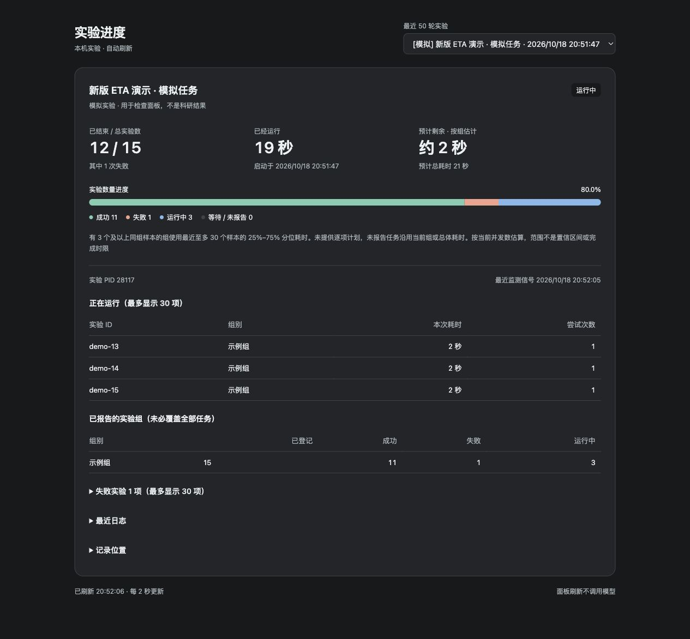

# Experiment Progress Skill

[简体中文](README.md) · [MIT license](LICENSE)

A local web dashboard for background experiments. It shows succeeded, failed, running, pending or unreported tasks, elapsed time, and an ETA when enough information is available. Use it through Codex, a command line, or Python.



Only synthetic tasks appear in the screenshot. The demo should finish with 14 successes and one intentional failure.

## Requirements

- Python 3.9+ and its standard library; no pip packages.
- Tested on macOS for the initial release. Linux has not been verified. Windows is not supported; the code uses `fcntl` and `ps`.
- A modern browser with `fetch` and `AbortSignal.timeout`. The dashboard and runtime messages are currently in Chinese; the usage instructions here cover the same features as the Chinese README.
- Experiments run on the local computer. This release does not add remote-server monitoring or web buttons to stop or retry tasks.

## Install and use in Codex

```text
$skill-installer Install https://github.com/ylimingtju/experiment-progress/tree/v0.2.0/skills/experiment-progress.
```

```text
$experiment-progress Add a web progress dashboard to this background experiment. Inspect the existing task list and logs first. Preserve the model, algorithm, seeds, solver limits, timing definitions, and existing notification preferences.
```

Once installed, Codex may select the skill when a request matches it. It is not an operating-system-wide process detector and cannot infer trial counts for arbitrary background commands. Full counts need stable task IDs and explicit task events. Existing reliable logs may be read through an adapter. Do not rerun experiments just to add progress tracking.

See the [official OpenAI instructions](https://learn.chatgpt.com/docs/build-skills) for installation and discovery. Use a skill directory supported by your host and compare existing copies before replacing local changes.

## Command-line demo

```sh
git clone https://github.com/ylimingtju/experiment-progress.git
cd experiment-progress
EP="$PWD/skills/experiment-progress/scripts/experiment_progress.py"
export EXPERIMENT_PROGRESS_HOME="$(mktemp -d)"
python3 "$EP" launch --demo --name "Demo experiments" --total 15 --open -- python3 "$PWD/skills/experiment-progress/scripts/demo.py"
```

The demo takes about 20 seconds, uses a temporary state directory, and performs no research computation. It includes one intentional failure. The launcher prints `run_id`, a local `url`, and `data_dir`. `--open` opens the browser. If opening fails, use the printed address rather than launching the batch again. Keep the printed data directory if you want to revisit the demo after leaving the shell.

For real experiments, omit `--demo`, supply the actual working directory and command, and use the actual task plan. For example:

```sh
python3 "$EP" launch --name "Parameter comparison" --cwd /absolute/project --plan /absolute/project/work/plan.json -- python3 -u driver.py
```

A plan is a JSON array:

```json
[{"id":"case-001","group":"small"},{"id":"case-002","group":"large"}]
```

The plan length supplies the total. Without a per-task plan, you can use `--total 120`; unreported tasks use the current single group or pooled samples from this run for a rough estimate. Supply the full plan when groups are known. Omit the total when it is unknown. The launched command must wait for all workers. Do not submit work and exit, add `nohup`, or append `&`.

## Report task events

Add the skill's `scripts/` directory to the experiment interpreter's module search path, for example through `PYTHONPATH` before running the launcher. Report at the original task boundaries:

```python
from experiment_progress import task, report

with task("algorithm-instance-parameter-seed", group="small"):
    run_existing_experiment()
```

`task()` records success on normal return and failure on an exception, then propagates the original exception. Monitoring errors only print a warning and do not change the experiment outcome. If the existing program encodes failure in a return value, use `report()` to follow that existing rule. A solver time limit may be a valid experimental outcome; it is not automatically an execution failure. Keep monitoring outside the original solver timing interval.

The launcher passes `EXPERIMENT_PROGRESS_RUN` and `EXPERIMENT_PROGRESS_HOME` to child processes. A retry keeps the same task ID and first reports `running`. Repeated terminal events do not double-count tasks. SQLite transactions combine writes from multiple processes.

## Common commands

```sh
python3 "$EP" dashboard --open
python3 "$EP" status --run RUN_ID
python3 "$EP" event running --run RUN_ID --task case-001 --group small
python3 "$EP" event succeeded --run RUN_ID --task case-001
python3 "$EP" attach --name "Existing experiment" --pid PID --cwd /absolute/project --total 120 --log /absolute/project/run.log
```

`attach` observes an existing process without restarting it. It cannot obtain that process's exit code or parse arbitrary logs into task outcomes. Add task events or a read-only adapter separately. When the process exits, the outcome remains unknown; this does not prove that all experiments succeeded.

## Supply an initial duration estimate

When comparable historical records, pilot records, or a user estimate exist, supply the duration of one task and its source at launch or attach time. Put these options before the experiment-command separator `--`. The 20 seconds below is only an argument example; replace it with a supported value:

```sh
python3 "$EP" launch --name "Parameter comparison" --cwd /absolute/project --plan /absolute/project/work/plan.json --estimate-seconds 20 --estimate-source "Replace with evidence from this project under the same settings" -- python3 -u driver.py
python3 "$EP" set-prior --run RUN_ID --seconds 20 --source "Replace with actual evidence"
python3 "$EP" set-prior --run RUN_ID --group small --seconds 20 --source "Replace with evidence for this group"
```

`set-prior` adds or updates a prior in an active run without restarting the experiment. Omit `--group` for a shared prior for groups without timed samples. Valid same-group samples take priority once available. Use `--estimate-seconds` and `--estimate-source` together; `attach` supports them too. Do not use whole-batch time or a solver limit as a mean task duration, run extra experiments just to estimate time, or automatically import records from other projects.

## ETA, records, and access

- Finished tasks include successes and failures. Exit code zero does not prove that every trial finished. Pending or unreported tasks remain visible.
- With one or two valid successful timed samples in a group, the page shows an early estimate using half the shortest to twice the longest sample. At three or more samples, it uses the 25th–75th percentile durations of up to 30 recent same-group samples.
- Without same-group samples, a group or shared prior takes priority: half to twice the supplied duration, labeled as an initial estimate with its source. Otherwise, it borrows up to 30 recent successful timed samples from this run, widens their 25th–75th percentile range to half its lower end through twice its upper end, and labels it a rough estimate across groups. Group differences may cause large errors.
- Remaining time uses the current concurrency and waiting tasks, subtracting time already spent on active tasks. When a task reaches or exceeds the old upper end, the estimated total duration per task in its group increases to 1.25–2 times the age of that group's longest-running task. The page labels this a dynamic rough estimate. These heuristic ranges are not confidence intervals, theoretical guarantees, or deadlines.
- ETA remains unknown without a total, active tasks, a current heartbeat, or either valid samples or a prior. Failed, untimed, and zero-duration events are excluded from timing samples.
- The estimate assumes independent tasks, comparable durations within each group, and unchanged concurrency. Dependencies, changing worker counts, long solver tails, and computer sleep can invalidate it. Task-count progress is not elapsed-time progress.
- The page reads the local service every two seconds without model calls. A stale heartbeat or read failure keeps the last data and shows a warning; it does not establish experiment failure.
- State defaults to `~/.codex/experiment-progress/`. Set `EXPERIMENT_PROGRESS_HOME` for an isolated directory. The page shows the latest 50 runs, up to 30 task details per category, and roughly the last 8 KB of logs. The local database retains the full state.
- The service binds only to `127.0.0.1` and uses a temporary access token with Host/Origin checks. Do not publish dashboard URLs, `server.json`, real logs, or databases. These runtime files are not needed in the repository.

## Verify and report issues

```sh
python3 -B skills/experiment-progress/scripts/test_monitor.py
```

The existing test checks counts, retries, concurrent writes, early/grouped/prior/overrun ETA, dashboard address reuse, stale heartbeats, HTTP access, detached launch, failed exits, and process observation. It uses a temporary state directory and stops its test service. It does not establish the scientific correctness of an experiment or verify Linux or Windows compatibility.

## Update from an older version

The current version is `v0.2.0`; the initial `v0.1.0` tag is preserved. Keep custom edits before updating the skill. Do not delete the state directory. Database access adds the `eta_priors` table when needed and retains existing runs and tasks. Replacing files does not update a running service automatically. Restart the dashboard service at a suitable time and reopen the page; do not restart experiments just to update the dashboard.

 For an issue, include the OS, Python version, a small synthetic task, and expected and observed states. Remove tokens, personal paths, and unpublished data.

Author: [Liming Yang](https://github.com/ylimingtju). Released under the [MIT license](LICENSE).
